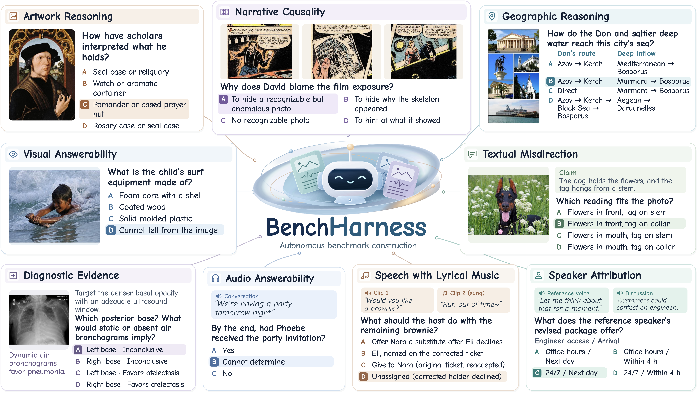
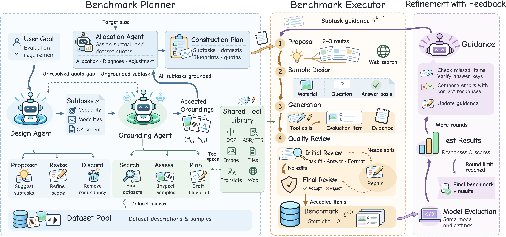

<div align="center">

# 🌍 Benchmark Everything Everywhere All at Once

<p><strong>BenchHarness</strong> builds custom benchmarks for language and multimodal models from natural-language evaluation goals.</p>

<a href="https://benchmarkagent.github.io/"></a>
<a href="https://arxiv.org/abs/2606.06462"></a>

<br>
<br>



</div>

## 🌟 Introduction

As models improve, scores on existing benchmarks can converge near the ceiling. BenchHarness lets researchers test specific capabilities with new questions grounded in annotated data. Describe the capability and the desired number of items, and BenchHarness finds suitable source material, constructs questions, and reviews the resulting items before export.

The paper evaluates 16 benchmarks with 200 items each across image-text, audio-text, and image-audio-text tasks. In paired comparisons on subsets of six benchmarks, generated items were harder for the evaluated models and revealed larger performance gaps than the corresponding source items.

## 🧠 Framework Overview

<p align="center">
  
</p>

<p align="center"><em>BenchHarness architecture.</em></p>

The **Benchmark Planner** turns a user goal into subtasks, dataset selections, construction blueprints, and sample quotas. The **Benchmark Executor** uses that plan to build and review individual items with a shared library of tools.

## ✨ Key Features

| Feature | What you can do |
| --- | --- |
| Natural-language task design | Specify the capability, conditions, and target size for a benchmark in a query JSON. |
| Dataset grounding | Reuse annotated sources selected for each subtask. Dataset cards describe what material is available and where to find it. |
| Multimodal construction | Build items with text, images, speech, or a combination of them. The executor can use tools such as OCR, image operations, and speech synthesis. |
| Review and reproducibility | Check task fit, reference answers, and output format. Keep intermediate artifacts so a run can resume from its cache. |

## 📌 Contents

- [Quick Start](#-quick-start)
  - [Installation](#installation)
  - [Configuration](#configuration)
  - [Prepare Inputs](#prepare-inputs)
  - [Run](#run)
- [How BenchHarness Works](#-how-benchharness-works)
- [To-Do List](#-to-do-list)
- [Citation](#-citation)

## ⚡ Quick Start

### Installation

Use Python 3.11 or later in a virtual environment.

```bash
git clone https://github.com/Shiyun-x/BenchHarness.git
cd BenchHarness
python -m pip install -e .
```

### Configuration

Use [utils/resources/models.yaml](utils/resources/models.yaml) as the model configuration. Set `api.base_url` to your provider endpoint and `api.api_key_env` to the name of the environment variable containing your API key. Set that variable in your shell and choose models available through your endpoint for the roles under `agents` and `tools`. Use `--model_config_path` to select a separate configuration.

### Prepare Inputs

**1. Choose a query.** Each query JSON contains an `id`, a natural-language `description`, and a `target_size`. The repository includes three examples.

| Query | Inputs | Evaluation goal |
| --- | --- | --- |
| [Artworks and Implicit Knowledge](user_queries/user_query_03.json) | Image + text | Use an unlabeled artwork to infer its identity, artist, or period, then answer an art-historical, biographical, or historical question. |
| [Speaker Attribution Under Continuous Music](user_queries/user_query_29.json) | Audio + text | Identify a target speaker from a reference voice and link their statements, conditions, and corrections across turns while music plays. |
| [Trimodal Detail QA and Answerability](user_queries/user_query_35.json) | Image + audio + text | Answer questions about visible details when the evidence supports an answer and choose "cannot determine" when it is insufficient. Speech may pose the question or provide context. |

**2. Prepare source datasets and cards.** Supply source JSON files and their associated media locally. Each source file has a `data` array with `id`, `input`, and `output` fields in each record. A dataset card describes the source and points to its JSON through `raw_meta.source_json`.

To build cards, set the source and output paths in [the card builder configuration](utils/build_dataset_cards/built_dataset_card.config.json), then run the builder.

```bash
python -m utils.build_dataset_cards.built_dataset_card
```

In [the dataset catalog](utils/resources/dataset_cards.yaml), set `dataset_card_dir` to your card directory and update `datasets` with the IDs you want to use. Choose sources that cover the example you plan to run.

### Run

Run from the repository root. Pass the query path without the `.json` extension.

```bash
python generate_benchmark.py --topic_id user_queries/user_query_03
```

Use `user_queries/user_query_29` or `user_queries/user_query_35` for the other examples. Pass `--dataset_card_config` to select a different dataset catalog.

For the artwork example, the default run directory is `cache/user_queries/user_query_03/`. It contains the intermediate artifacts and the exported `evaluation.json`. Reuse the directory to resume, or pass a different `--cache_path` prefix ending in a slash to start a fresh run.

**Render audio.** When a run generates speech jobs, it also writes `evaluation_with_audio_settings.json`. Set `MINIMAX_API` to render the audio. For the continuous-music example, point `--music-root` to a local JamendoLyrics library.

```bash
python synthesize_audio.py --input-cache-dir cache/user_queries/user_query_29 --music-root /path/to/JamendoLyrics
```

Omit `--music-root` for runs without background-music jobs. The audio step writes playable media and `evaluation_ready.json` to the run directory.

## ✨ How BenchHarness Works

1. **Design and grounding.** The Design Agent breaks the requirement into testable subtasks with modality and answer constraints. The Grounding Agent searches candidate datasets, inspects representative samples, and drafts blueprints for the sources it selects.
2. **Allocation.** The Allocation Agent assigns quotas across subtasks and datasets based on task priority and source capacity.
3. **Execution and review.** The Executor proposes ways to turn a source record into an item, designs the question and answer basis, and constructs the item with the required tools. Review checks task fit, answer validity, and format. Items can be repaired and reviewed again before acceptance and export.

## 📋 To-Do List

Roadmap items for upcoming releases. Contributions welcome! Please open an issue or PR if you'd like to help.

- [ ] **Interactive UI**

## 📖 Citation

```bibtex
@misc{xiong2026benchmark,
  title={Benchmark Everything Everywhere All at Once},
  author={Shiyun Xiong and Dongming Wu and Peiwen Sun and Yuang Ai and Bokang Yang and Wencheng Han and Xiao-Hui Li and Xiangyu Yue},
  year={2026},
  eprint={2606.06462},
  archivePrefix={arXiv},
  primaryClass={cs.AI},
  url={https://arxiv.org/abs/2606.06462}
}
```
